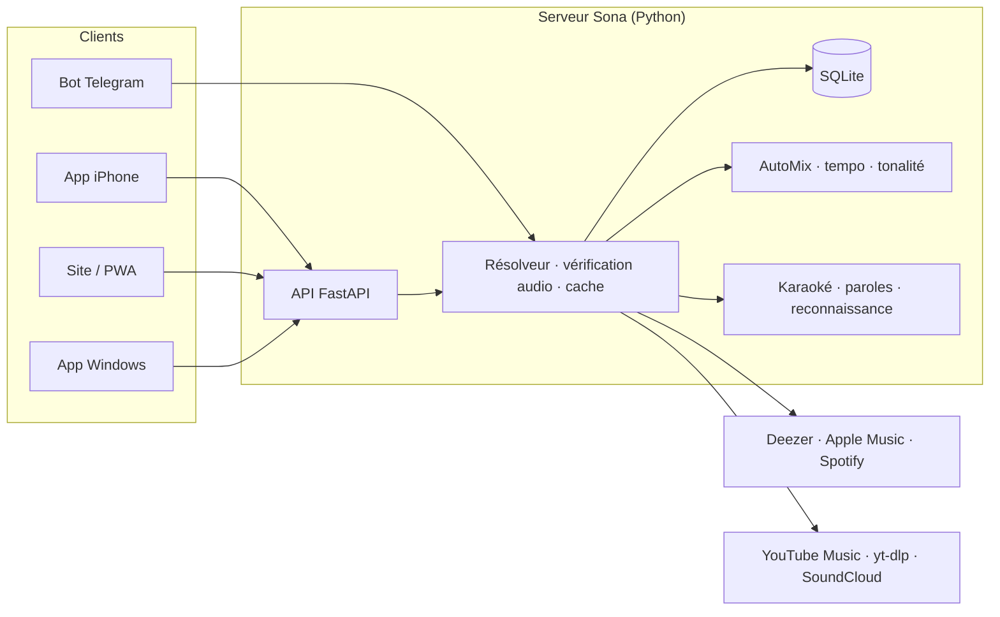

<div align="center">

[English](README.md) · **Français**

# Sona

**Ta musique, en clair.**

Un lecteur de musique complet — app iPhone, site, app Windows et bot Telegram — qui tourne sur ton propre serveur.<br>
Recherche, écoute instantanée, paroles synchronisées, karaoké, mix automatique, écoute à plusieurs.

[](https://github.com/trysona/sona/actions/workflows/tests.yml)
[](https://github.com/trysona/sona/actions/workflows/ios.yml)
[](https://github.com/trysona/sona/actions/workflows/windows.yml)


</div>

---

## Pourquoi Sona

Les métadonnées viennent de **Deezer**, d'**Apple Music** et de **Spotify** (pochettes, tracklists, artistes, dates de sortie).
L'audio est retrouvé et **vérifié** avant d'être joué : Sona compare le fichier à l'extrait officiel au lieu de te servir « un titre qui ressemble ».
Une seule API, un seul compte, et le même catalogue partout : sur iPhone, sur le site, sur Windows et dans Telegram.

## Ce qu'il y a dedans

### Écouter
- **Lecture instantanée** : un titre pas encore en cache démarre en quelques secondes pendant que la version vérifiée se prépare en arrière-plan ; le suivant de la file est préparé à l'avance.
- **Recherche tolérante** (Deezer d'abord, puis Apple Music et YouTube Music en secours), avec les exclus et les artistes de ta bibliothèque.
- **Paroles synchronisées**, **karaoké** (séparation voix / instrumental par IA, sur CPU), et **reconnaissance de titre** (« c'est quoi cette chanson ? »).
- **Qualité maximale** : musique locale lossless (FLAC, ALAC, WAV…) servie telle quelle quand tu l'as, avec le bon fichier même pour un titre d'une autre source.

### Mixer
- **AutoMix** : le tempo, la grille de temps, le premier temps de chaque mesure et la tonalité (code Camelot) de chaque titre sont mesurés ; les enchaînements sont calés sur les mesures, avec effets, sans coupure.
- **Radios**, **mix du jour**, **radio DJ** avec voix de DJ, minuteur de sommeil intelligent (le titre se termine en fondu), **réveil musical**.
- **Égaliseur 5 bandes**, volume égalisé, fondu entre les titres.

### Partager
- **Sona Connect** : tous tes appareils se voient. Lance la musique sur le PC depuis l'iPhone, même en 4G, même fenêtre fermée.
- **Écoute ensemble** : une session à plusieurs, chacun propose des titres.
- **Amis et Blend**, playlists collaboratives, classements de la semaine, défis et badges.
- **Diffusion sur TV / PS5** depuis l'app.

### Découvrir
- **Sorties annoncées** avec compte à rebours (minuit à Paris), titres grisés tant qu'ils ne sont pas sortis, pochette et tracklist récupérées sur Apple Music quand Deezer n'a rien.
- **Stats complètes**, carte de tes écoutes, récaps en story, souvenirs.
- **Exclus** : titres inédits rangés par artiste.
- **Thème GTA VI** : sur la page de Grand Theft Auto VI, et dès qu'un titre de l'album joue, Sona se transforme en Vice City (coucher de soleil néon, soleil rayé, palmiers, lettrage rose et orange). Se coupe dans Réglages > Apparence.

## Les applications

| | |
|---|---|
| **iPhone** — `ios/` | App SwiftUI native : widgets, Live Activities, Siri et bouton Action, mode voiture, téléchargements hors ligne, notifications. Compilée par GitHub Actions. |
| **Web** — `web/` | Le même Sona dans le navigateur, sur ordinateur et téléphone. Installable (PWA). |
| **Windows** — `desktop/` | Le site dans une vraie fenêtre « verre liquide » (Electron), avec Sona Connect et une télécommande par QR code. |
| **Telegram** — `app/bot/` | Le bot d'origine : cherche et envoie les morceaux dans la conversation, avec une interface en écrans plutôt qu'en commandes. |

## Architecture



Tout le serveur est un seul processus Python : `app/api` (routes), `app/bot` (Telegram), `app/providers` (Deezer, Apple, Spotify, YouTube, SoundCloud), `app/services` (analyse audio, karaoké, paroles, stats, sorties annoncées…), `app/db` (SQLite).

## Démarrage rapide

Il te faut Python 3.11 à 3.13 (3.12 recommandé) et [FFmpeg](https://ffmpeg.org/).

```bash
git clone https://github.com/trysona/sona.git
cd sona
python -m venv .venv
.venv/bin/pip install -r requirements.txt     # Windows : .venv\Scripts\pip
cp .env.example .env                          # puis renseigne API_TOKEN
.venv/bin/python run_api.py                   # API + site sur http://127.0.0.1:8000/web/
```

Pour le bot Telegram, ajoute `BOT_TOKEN` et `ALLOWED_USER_IDS` dans `.env`, puis `python run.py`.

Cookies YouTube pour un serveur, déploiement automatique, sauvegardes, configuration complète : tout est dans le **[guide complet](docs/GUIDE.md)**.

## Tests

```bash
pip install pytest
python -m pytest tests -q
```

Plus de 650 tests, sans aucun appel réseau : les providers sont remplacés par des faux. La CI les lance à chaque PR, et un merge sur `master` ne déploie que si elles passent.

## Documentation

| | |
|---|---|
| [Guide complet](docs/GUIDE.md) | Installation, cookies YouTube, bot, API, site, application Windows, limites connues |
| [Déploiement](docs/DEPLOIEMENT.md) | Déploiement automatique sur un serveur par GitHub Actions |
| [Passer sur Oracle Cloud](docs/MIGRATION_ORACLE.md) | Héberger Sona gratuitement sur une machine ARM |
| [Parcours du bot](docs/UX_FLOW.md) | Écrans, navigation et callbacks du bot Telegram |
| [App Windows](desktop/README.md) · [App iPhone](ios/Encre/README.md) | Construire et lancer chaque application |

## À savoir

Sona est pensé pour un **usage privé** : pas de service public, un serveur par personne ou par groupe d'amis. L'audio est téléchargé depuis YouTube et SoundCloud, ce qu'Apple n'autorise pas sur l'App Store : l'app iPhone se compile et s'installe toi-même (build Xcode ou sideload), elle n'est pas faite pour être publiée. N'expose pas l'API sur Internet sans réfléchir à qui peut s'y connecter.
