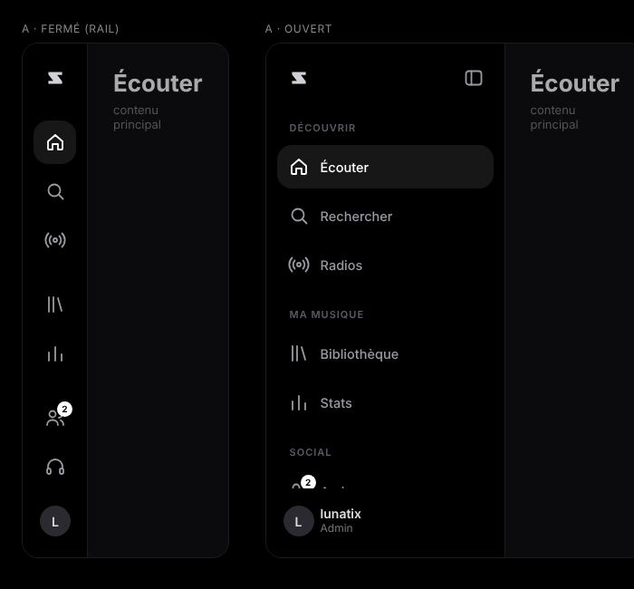
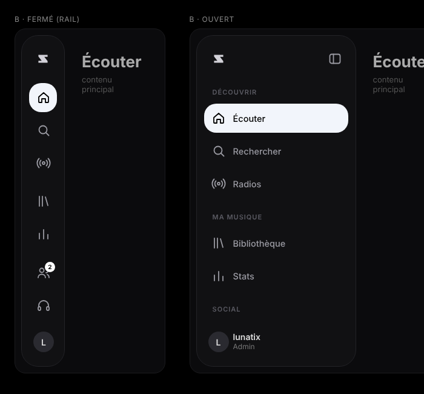
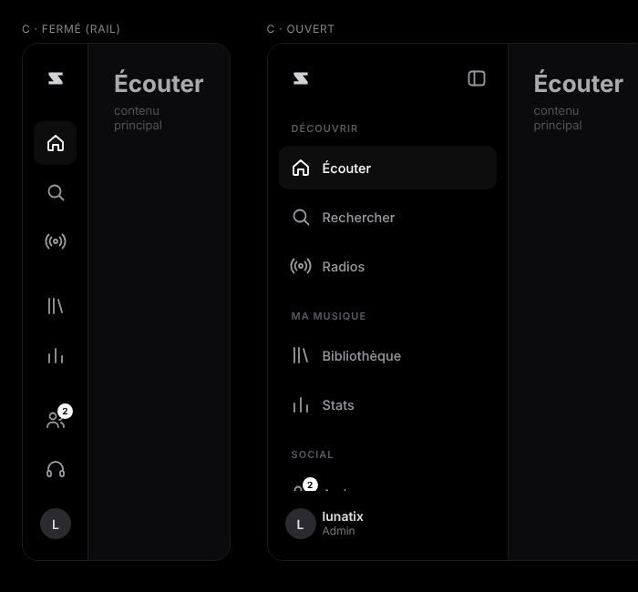

# Menu latéral : trois variantes, une retenue

Les trois maquettes (HTML autonome + capture) montrent le même contenu, fermé (rail de 72 px) et ouvert (panneau de 264 px) :

| | Variante | Caractère |
|---|---|---|
|  | **A — Pilule** | noir pur collé au bord de la fenêtre, filet très fin, pastille douce pour la page active + point discret |
|  | B — Flottante | carte arrondie détachée du bord, léger flou, pastille pleine claire |
|  | C — Filet | comme A, rayons plus francs, trait d'accent sur le bord gauche |

## Choix final : B « Flottante » (décision de Lunatix)

J'avais d'abord retenu A (noir pur collé au bord, le plus simple à animer proprement). Tu as préféré B : une carte arrondie détachée des bords, qui donne
plus de caractère. C'est elle qui est implémentée (`web/sidebar.css`, `web/sidebar.js`), avec ce qu'il a fallu régler pour qu'elle reste sans défaut :

- **Contour qui suit le repli** : deux calques (un anneau de 1 px et la face) rognés ensemble par `clip-path` avec le même rayon et la même courbe ;
  la carte se replie de 264 à 72 px sans jamais animer sa largeur.
- **Pastille de la page active** : pleine, de la couleur d'accent (la seule chose colorée du menu) ; au repos elle est rognée à 48 × 48 px pour ne pas
  être coupée net au bord de la carte.
- **Marge de 12 px** autour de la carte : la colonne de la grille vaut 84 px (rail) ou 276 px (ouvert) et le contenu garde 12 px d'écart.
- **Au survol** (rail) : la carte se déplie par-dessus la page sans la pousser.
- Liste des playlists qui se fond en bas au lieu d'être coupée net.
